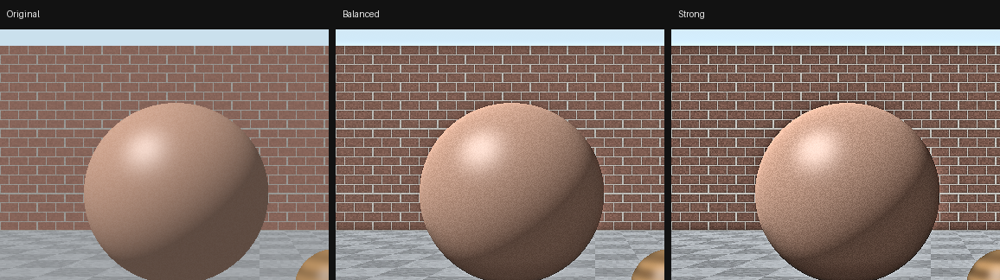
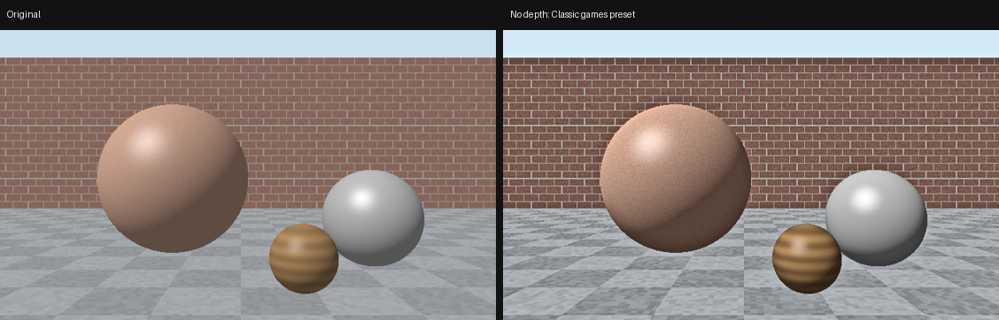
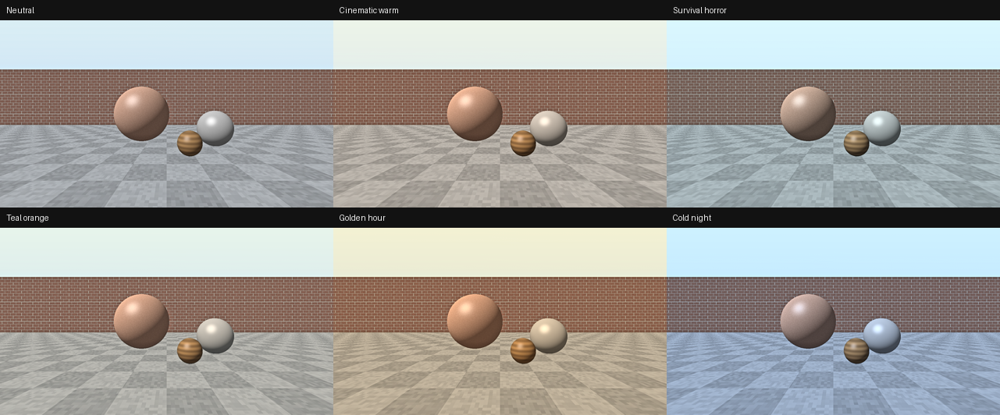
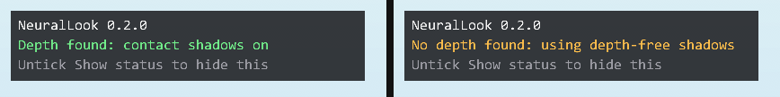
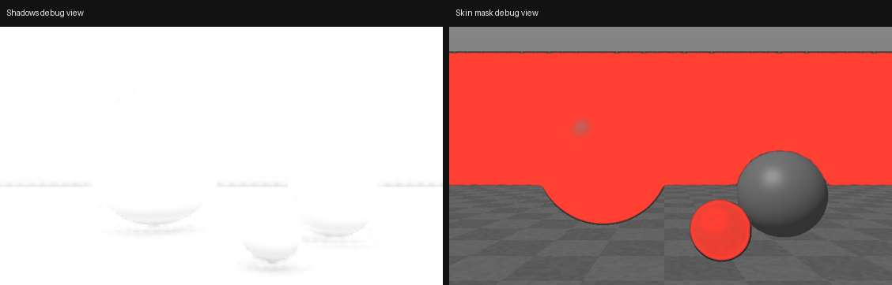

# NeuralLook

A ReShade shader that brings a neural-rendering-style look to older GPUs: richer lighting on faces and surfaces, more material detail, deeper shadows, warmer and less waxy skin, plus mood grades and soft light glow. Built and tuned for the GTX 1650.


<sub>Synthetic test scene: original, Balanced preset, Strong preset. Game screenshots will be added after the Resident Evil testing round.</sub>

> **Status: v0.2.0, under testing.** Being tested in **Resident Evil 0 HD Remaster** and **Resident Evil 2** (2019) on a GTX 1650. RE0 runs, and depth-free mode was added for it. RE2 testing is next. Expect settings and presets to change.

---

## Why

NVIDIA's DLSS 5 Neural Rendering changes how lighting and materials look, especially on skin, hair and fabric, but it needs tensor cores. It costs a large share of the frame rate even on high-end cards, and it can't run at all on GTX cards such as the 1650 or 1660.

NeuralLook goes after the same kind of look with ordinary shader math, at a cost a GTX 1650 can afford. It is an imitation, not a port. No AI model runs, and no NVIDIA files are used or needed.

## What it does

| Part | Effect | Needs depth? |
|---|---|---|
| Core look | Local lighting contrast, adaptive material detail, highlights that pick up surface texture, a gentle filmic curve, vibrance | No |
| Shadows | Contact shadows from depth in creases, joints and where objects meet the ground. In games with no depth, depth-free shadows worked out from the image take over automatically | Optional |
| Skin | Warm light wrap at the light/shadow edge (like subsurface scattering), redder shadowed skin, extra skin texture | No |
| Mood | Colour grades: Cinematic warm, Survival horror, Teal and orange, Golden hour, Cold night | No |
| Lens and atmosphere | Soft light glow around bright areas, vignette, film grain | No |
| Tools | Light / Balanced / Strong / Classic games presets, on-screen status, split-screen compare, debug views | No |

Heavy work runs at half and quarter resolution.

**Works without depth.** Some games, especially ones with pre-rendered backgrounds like Resident Evil 0, don't give ReShade a usable depth buffer. NeuralLook checks for this every frame and switches to depth-free shadows on its own.



**Mood grades**, shown here at full strength:



**Status badge**, shown only while the ReShade menu is open:





## What it doesn't do

- **It doesn't generate detail.** It only strengthens detail already in the frame. Low-resolution textures stay low resolution.
- **It doesn't recognise materials.** Skin is found by colour, so brick, wood and sand can be treated as skin. The Skin detection width slider and the Skin mask debug view help with this.
- **Depth-free shadows are an estimate.** They darken areas that look like creases and corners from their brightness, so they can't tell a dark object from a shadowed one. Contact shadows from depth are more accurate when a game provides depth.
- **It doesn't relight the scene.** It can't add light that isn't there or fix wrong lighting.
- **It doesn't upscale or generate frames.** For that, pair it with your game's upscaler or a tool like OptiScaler (FSR/XeSS).
- **No HDR support yet.** Turn HDR off in the game.

## NeuralLook vs DLSS 5 Neural Rendering

| | NeuralLook | DLSS 5 Neural Rendering |
|---|---|---|
| How it works | Hand-written shaders on the final image, plus depth when available | AI model that re-shades lighting and materials from game data |
| GPUs | Anything ReShade runs on; tuned for GTX 1650 | RTX 50 officially; RTX 20–40 only through community mods |
| Performance cost | Light (being measured on GTX 1650) | Heavy: roughly half the frame rate in early reviews |
| Skin | Colour-based mask, light wrap, texture boost | Recognises skin, hair and fabric; adds subsurface scattering and pore detail |
| New detail | No, enhances what is there | Yes, generates lighting and material detail |
| Games | Most DirectX 9–12, OpenGL and Vulkan games ReShade supports, with or without depth | Games with official support, or others through mods |

DLSS 5 details come from public reviews such as [Notebookcheck](https://www.notebookcheck.net/First-DLSS-5-game-tested-DLSS-5-humbles-RTX-5090-with-over-50-performance-loss.1391978.0.html) and [TechSpot](https://techspot.com/article/3170-real-dlss-5-performance).

---

## How to use it (step by step)

### What you need

- Windows and a game that ReShade supports
- [ReShade](https://reshade.me) 5.0 or newer (the normal version is fine)
- `NeuralLook.fx` from the [Releases](../../releases) page or the `Shaders` folder of this repo

Don't use ReShade in online games with anti-cheat.

### 1. Install ReShade

1. Find the game's folder, the one containing its `.exe`. In Steam, right-click the game, then **Manage → Browse local files**.
2. Run the ReShade installer and select the game's `.exe`.
3. Choose the game's graphics API (for example DirectX 10/11/12, or Direct3D 9 for older games).
4. When it lists effect packages, keep **Standard effects** ticked. NeuralLook needs `ReShade.fxh`, `DrawText.fxh` and `FontAtlas.png` from that package.
5. Finish the installer.

### 2. Add NeuralLook

1. Copy `NeuralLook.fx` into the game folder, inside `reshade-shaders\Shaders\`. If you're updating from an older version, replace the old file.
2. Start the game. A ReShade banner appears at the top of the screen.
3. Press **Home** to open the ReShade menu, and skip the tutorial if it shows.
4. Tick **NeuralLook** in the effect list.

### 3. Check the status badge

While the menu is open, a small badge in the top-left corner shows what NeuralLook found:

- **Green, "Depth found: contact shadows on"**: the game gives ReShade depth. Nothing else to do.
- **Amber, "No depth found: using depth-free shadows"**: the game doesn't give ReShade depth, so NeuralLook uses depth-free shadows instead. Everything else works as normal. This is expected in Resident Evil 0 HD Remaster.

The badge never appears while you play. To turn it off, untick **Show status**.

<details>
<summary><b>Optional: trying to get depth working</b></summary>

You only need this if the badge is amber in a fully 3D game and you want contact shadows.

1. Tick **DisplayDepth** in the effect list. If it shows a flat blue or white screen, ReShade isn't receiving depth.
2. Open the **Add-ons** tab, expand **Generic Depth**, and try ticking **Copy depth buffer before clear operations**. If the list shows several depth buffers, try selecting another one.
3. If DisplayDepth shows a picture that is upside down or inverted, click **Edit global preprocessor definitions** at the bottom of the **Home** tab and flip `RESHADE_DEPTH_INPUT_IS_UPSIDE_DOWN` or `RESHADE_DEPTH_INPUT_IS_REVERSED` between 0 and 1.
4. Untick DisplayDepth when you're done. If none of this helps, leave it: NeuralLook already works without depth.

</details>

### 4. Pick a look

1. **Look preset**:
   - **Balanced** for fully 3D games such as Resident Evil 2.
   - **Classic games (pre-rendered backgrounds)** for fixed-camera games such as Resident Evil 0 and the Resident Evil HD Remaster. It keeps fine detail low so compressed backgrounds don't get noisy, and pushes shaping, shadows and skin instead.
   - **Light** or **Strong** for less or more.
2. **Mood**: try **Survival horror** for the Resident Evil games, at a **Mood strength** around 0.5–0.7.
3. Open **Lens and atmosphere** and set **Light glow** (lamps, windows, fire), **Vignette** and **Film grain** to taste.
4. Turn on **Split-screen compare** (under **Compare and debug**): the left side shows NeuralLook, the right side the original game. Drag **Split position** to move the line. Turn it off when you're done.

### 5. Fine-tune (optional)

- **Overall strength** scales everything NeuralLook does. 0 turns it off.
- To set each effect yourself, choose **Custom** as the Look preset and open the **Custom** sections.
- Set **Debug view** to **Shadows** to see exactly where shadows are added. With depth, adjust **Contact shadow radius** (under **Scene settings**) until shadows sit in corners and under feet without dark halos.
- Set **Debug view** to **Skin mask**. If walls or wood show up red, lower **Skin detection width**.
- Set **Debug view** back to **Off**.

ReShade saves your settings to its preset file automatically.

### 6. Check performance

1. Open the **Statistics** tab to see how many milliseconds NeuralLook takes.
2. In the **Settings** tab, set an effect toggle key so you can compare frame rates with it on and off.
3. If it's too heavy, try these in order:
   - **Contact shadow quality** → **Fast**
   - **Shadows** → **Depth-free shadows only** (skips the contact shadow work)
   - **Light glow** → 0
   - At the bottom of NeuralLook's settings, set `NL_CONTACT_SHADOWS` to 0, then `NL_SKIN` to 0

---

## Game notes (under testing)

### Resident Evil 0 HD Remaster

- The game runs on **DirectX 9**, so choose **Direct3D 9** in the ReShade installer.
- In the first test, the game didn't give ReShade a depth buffer. NeuralLook now detects this and uses depth-free shadows; the badge shows amber.
- Suggested starting point: **Classic games** preset, **Survival horror** mood at 0.6, **Light glow** 0.25.
- Backgrounds are pre-rendered, so the skin pass mostly affects characters.

### Resident Evil 2 (2019)

- Install ReShade for `re2.exe` with **DirectX 10/11/12**.
- Turn **HDR off** in the game's display settings.
- If ReShade doesn't load with the current DirectX 12 version, use the original DirectX 11 release from Steam: **Properties → Betas** lists the non-ray-traced branch.
- Good test spots: the police station hall and close-ups of Leon or Claire.

Results, screenshots and recommended settings for both games will be added here once testing is done.

## Settings reference

**Main**

| Setting | What it does |
|---|---|
| Look preset | Light, Balanced, Strong or Classic games. Custom uses the Custom sliders |
| Overall strength | Scales everything; 0 turns NeuralLook off |
| Mood, Mood strength | Colour grade and how strongly it applies |
| Shadows | Auto (contact shadows when depth exists, depth-free otherwise), contact only, depth-free only, or off |
| Contact shadow quality | Fast, Normal or High |
| Show status | Badge in the top-left while the ReShade menu is open |

**Lens and atmosphere**

| Setting | What it does |
|---|---|
| Light glow, Glow threshold | Soft glow around bright areas, and how bright an area must be to glow |
| Vignette | Darker corners |
| Film grain | Fine moving grain, strongest in the mid-tones |

**Custom** (when Look preset is Custom)

| Setting | What it does |
|---|---|
| Lighting contrast | Deeper light/shadow shaping on faces, cloth and walls |
| Material detail | Fine surface texture, adaptive so noise and flat areas stay calm |
| Textured highlights | Breaks up smooth, plastic-looking highlights |
| Filmic contrast | Gentle S-curve |
| Vibrance | Lifts muted colours; skin is protected |
| Contact shadow strength | How dark contact shadows from depth get |
| Depth-free shadow strength | How dark depth-free shadows get |
| Skin light wrap | Warm light bleeding into the shadow side of skin |
| Skin detail | Variation and texture on skin |

**Scene settings**

| Setting | What it does |
|---|---|
| Contact shadow radius / distance | Size of contact shadows and how far into the scene they appear |
| Game vertical field of view | Match the game for correct contact shadow shapes |
| Skin detection width | Narrow it if non-skin surfaces are picked up |

**Compare and debug**: Split-screen compare, Split position, Debug view (Shadows, Skin mask, Lighting contrast).

| Preprocessor switch | Default | Use |
|---|---|---|
| `NL_CONTACT_SHADOWS` | 1 | 0 removes all depth work; depth-free shadows still work |
| `NL_SKIN` | 1 | 0 removes the skin pass |

## Troubleshooting

- **Error about `ReShade.fxh`, `DrawText.fxh` or `FontAtlas.png`**: reinstall ReShade with the standard effects package ticked.
- **Badge is amber**: the game isn't giving ReShade depth. NeuralLook still works; see the optional depth steps in step 3 if you want contact shadows.
- **Dark halos around objects**: lower Contact shadow radius, or lower Depth-free shadow strength (Custom preset).
- **Image looks grainy**: lower Material detail and Skin detail, set Film grain to 0, or turn off the game's own film grain.
- **Colours look washed out or wrong**: turn HDR off in the game, and check the Mood setting.

---

## Changelog

**v0.2.0**
- Automatic depth detection, with depth-free shadows for games without depth
- Mood colour grades: Cinematic warm, Survival horror, Teal and orange, Golden hour, Cold night
- Lens and atmosphere: light glow, vignette, film grain
- Classic games preset for pre-rendered backgrounds
- Status badge while the ReShade menu is open
- Shadows and Contact shadow quality dropdowns replace the `NL_AO_SAMPLES` switch

**v0.1.0**
- First testing build: core look, contact shadows, skin pass, presets, compare and debug views

## Roadmap

**v0.3: real-game tuning**
- Finish testing in RE0 HD Remaster and RE2 on a GTX 1650
- Measured performance numbers and recommended settings per game
- Before/after game screenshots in this README

**v0.4: quality**
- Depth-aware lighting contrast to remove the remaining edge halos
- Better skin detection that uses depth as well as colour, to cut false positives on brick and wood
- Backlit edges on hair and foliage (light passing through thin surfaces)
- Steadier contact shadows in motion

**Later**
- HDR (scRGB and HDR10) support
- A simple installer script
- More tested games, based on requests

## Testing and feedback

Every push compiles the shader with ReShade's own compiler for DirectX 9, DirectX 10–12, OpenGL and Vulkan, at several resolutions and with each switch on and off. It also renders a test scene through every pass, with and without depth, and checks the result. You can run the same checks on Linux:

```
bash tools/build_fxc.sh build
bash tools/check_shader.sh build
python3 tests/render_test.py build     # needs moderngl, numpy, pillow and Mesa
```

The most useful feedback right now is from real games. When opening an issue, please include:

- the game, your GPU and resolution
- whether the status badge is green or amber
- screenshots with NeuralLook off and on, plus the Shadows and Skin mask debug views
- the time NeuralLook takes in ReShade's Statistics tab

## License

MIT. See [LICENSE](LICENSE).

NeuralLook is an independent project. It is not affiliated with or endorsed by NVIDIA, Capcom or the ReShade project. DLSS is a trademark of NVIDIA Corporation, and Resident Evil is a trademark of Capcom.
